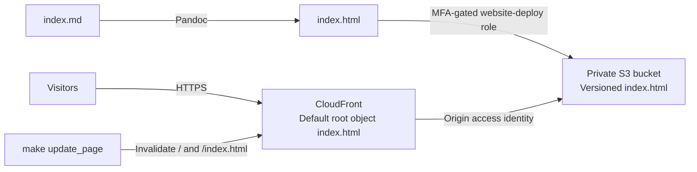

# Site architecture

The deploy role writes the homepage object and requests a cache invalidation
on the site distribution. CloudFront distribution configuration and bucket
settings are managed separately from publishing. S3 keeps earlier revisions
of the homepage for rollback.
